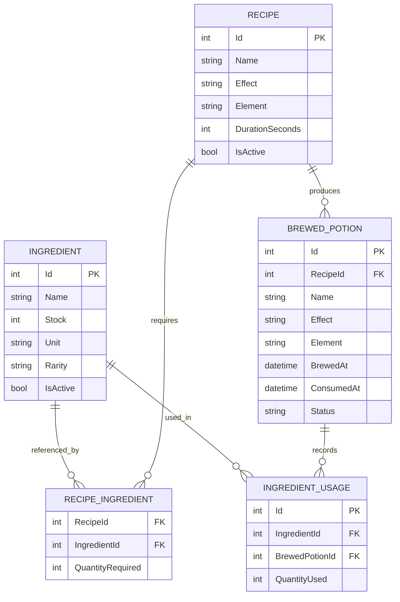
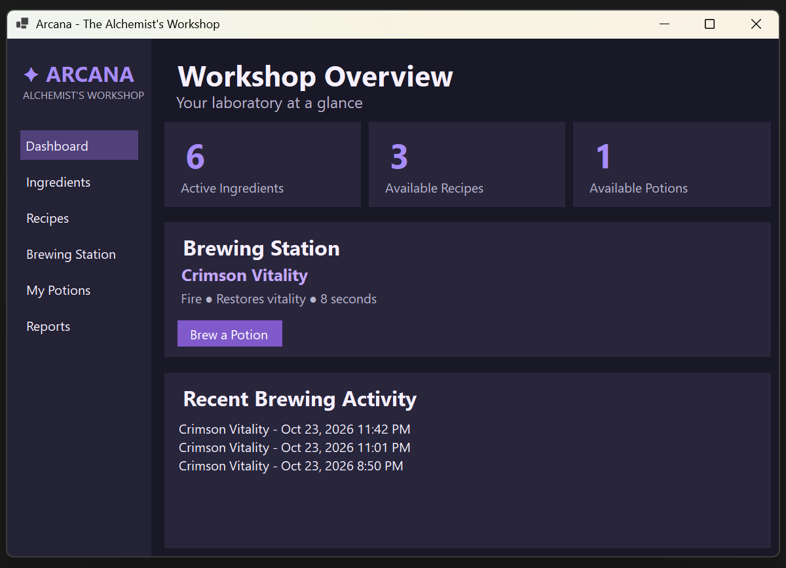
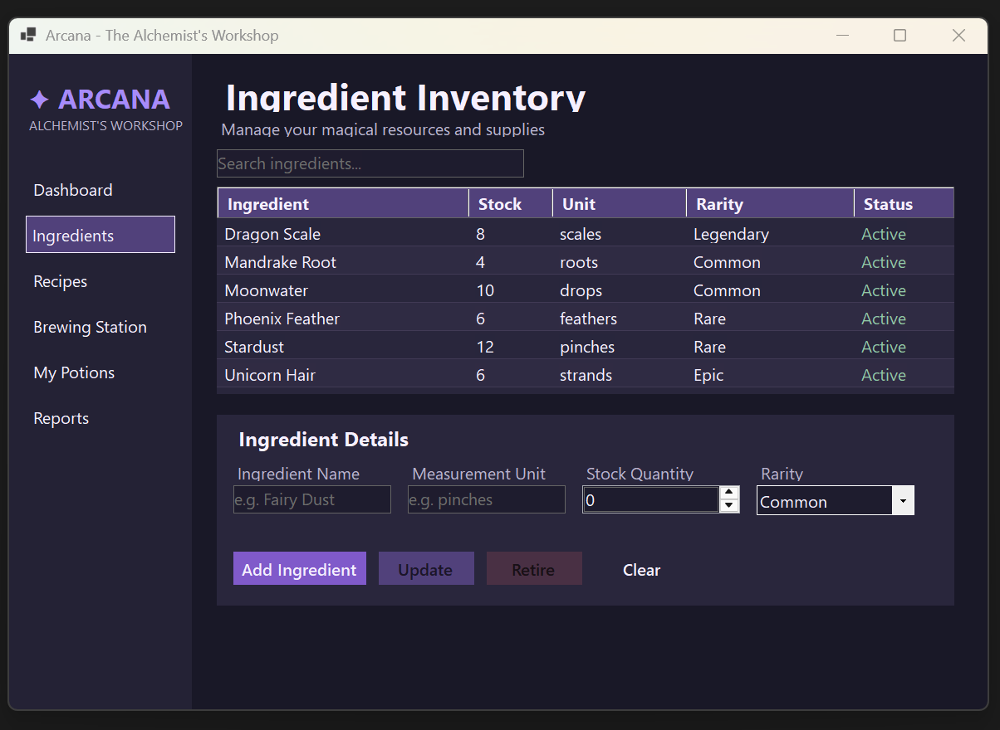
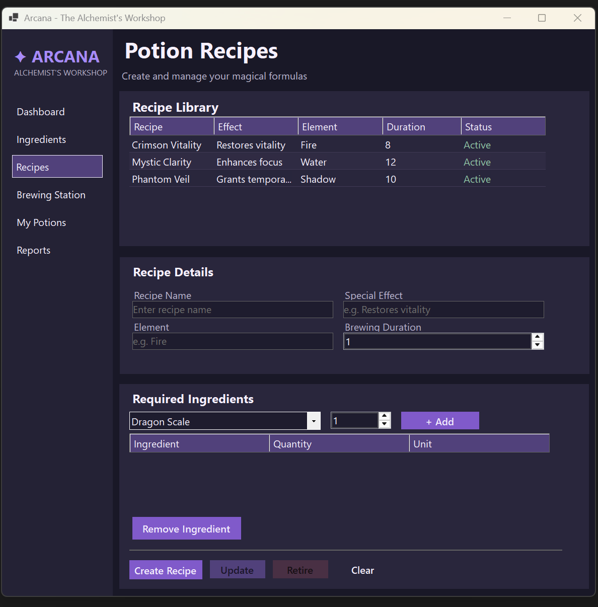
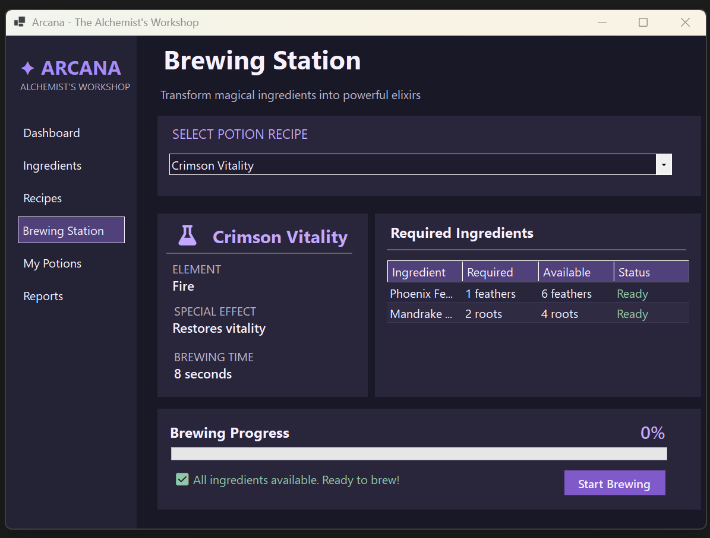
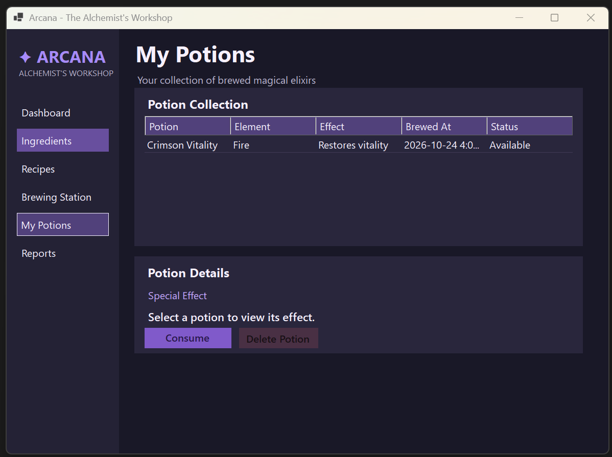
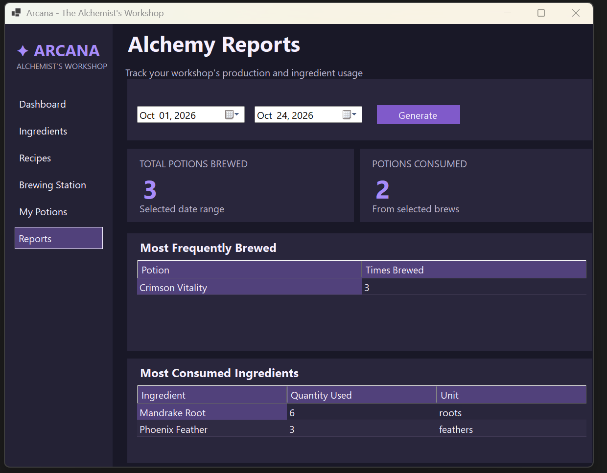

# Arcana - The Alchemist's Workshop

Arcana is a fantasy-themed desktop application for managing magical ingredients, designing potion recipes, brewing custom elixirs, and reviewing laboratory production. It was developed in **C# with Windows Forms**, **Entity Framework Core**, and **SQLite**.

## Features

- **Ingredient inventory:** View, search, add, and update ingredients with a name, stock quantity, measurement unit, and rarity. Retire ingredients when they are not referenced by active recipes.
- **Recipe management:** Create, edit, view, and retire potion recipes. Each recipe includes a name, effect, element, duration in seconds, and one or more ingredient requirements.
- **Brewing station:** Select a recipe, check stock before starting, and monitor progress using a non-blocking WinForms timer and progress bar. At completion, inventory is checked again and ingredients, potion, and usage records are saved together in a database transaction.
- **Potion inventory:** View brewed potions, consume one using a confirmation dialog that displays its effect, or remove it from the available inventory. Consumption and deletion preserve production history.
- **Reports:** View frequently brewed potions, most-used ingredients, and total brewing throughput for a selected date range.
- **Dashboard:** Summary counts for active ingredients, active recipes, and available potions.

## Potion and Ingredient domain

### Ingredients

Each ingredient has a unique name, stock quantity, a unit (such as *drops*, *feathers*, *roots*, *strands*, *pinches*, or *scales*), a rarity (`Common`, `Uncommon`, `Rare`, `Epic`, or `Legendary`), and an active/retired flag. Rarity is represented by a C# enum and stored as text in SQLite.

Example seed ingredients are **Moonwater**, **Phoenix Feather**, **Unicorn Hair**, **Mandrake Root**, **Stardust**, and **Dragon Scale**.

### Recipes

A recipe specifies the finished potion's name, special effect, element, brewing duration, and required ingredient quantities. A recipe is a **blueprint**; it does not itself represent a brewed potion. Multiple potions can be brewed from one recipe.

The initial recipes are **Crimson Vitality** (restores vitality), **Mystic Clarity** (enhances focus), and **Phantom Veil** (temporary invisibility).

### Brewed potions

A successful brew creates an individual potion with a snapshot of its name, effect, and element; a recipe reference; a brewing timestamp; and a status (`Available`, `Consumed`, or `Deleted`). A consumed potion also records its consumption timestamp.

### Business rules

1. Ingredient stock and recipe quantities must be valid nonnegative/positive whole numbers, respectively.
2. Recipes must have a nonempty name, effect, element, positive duration, and at least one ingredient. The same ingredient cannot appear twice in a recipe.
3. Ingredient names and recipe names must be unique.
4. Ingredients used by active recipes cannot be retired.
5. Only active recipes and active ingredients can be used for brewing.
6. Brewing starts only if every required ingredient is in stock. Stock is checked again at completion.
7. Successful brewing deducts ingredient stock and records the finished potion and usage history atomically.
8. A potion can only be consumed while its status is `Available`.
9. Deletion uses a status change so historical brewing and ingredient-usage reports remain intact.

## Technology

- C# and .NET Windows Forms
- Visual Studio with WinForms Designer
- Entity Framework Core with the SQLite provider
- SQLite database (`arcana.db`)
- LINQ, repositories, and services
- Git and GitHub

## Project structure

```text
Arcana/
├── Models/          # Ingredient, Recipe, RecipeIngredient,
│                    # BrewedPotion, IngredientUsage, report models
├── Data/            # AlchemyContext (EF Core configuration and seed data)
├── Repositories/    # Data retrieval and persistence operations
├── Services/        # Brewing validation and completion logic
├── Forms/           # Designer-built WinForms screens and dialogs
├── Migrations/      # Versioned EF Core database schema
├── Assets/          # Visual assets
├── UI/
├── Program.cs       
└── Arcana.csproj
```

## Database relationships



`RecipeIngredient` has a **composite primary key** of `(RecipeId, IngredientId)`. Foreign keys use restricted deletion where required to preserve linked records.

## Setup and database initialization

1. On Windows, install **Visual Studio** with the **.NET desktop development** workload and the .NET SDK matching the target framework in `Arcana.csproj`.
2. Clone the GitHub repository or extract the submitted source ZIP.
3. Open the solution (`.sln` or `.slnx`) in Visual Studio, or open `Arcana.csproj` if a solution file is not present.
4. Let Visual Studio restore NuGet packages. The project uses `Microsoft.EntityFrameworkCore.Sqlite` and `Microsoft.EntityFrameworkCore.Tools`; restore the versions recorded in the project.
5. Build the solution, then press **F5** to run it.
6. On startup, `Program.cs` calls `Database.Migrate()`. This creates or updates the local SQLite database using the checked-in migration files and loads the initial seed data on first creation.

### Database Setup

Arcana uses **SQLite** with Entity Framework Core for data persistence.

The application automatically creates and initializes the SQLite database (`arcana.db`) when launched for the first time.

Pending database migrations are applied automatically using `Database.Migrate()` in `Program.cs`.

The database is seeded with six magical ingredients, three potion recipes, and their required ingredient quantities.

No manual database configuration is required.

### Database Location

`AlchemyContext` builds the connection string from `AppContext.BaseDirectory`, so `arcana.db` is created alongside the running application, typically under `bin/Debug/<target-framework>/` during development. The database is local; **SQL Server and SSMS are not required**.

## Using Arcana

1. Open **Ingredients** to review or add supplies.
2. Open **Recipes** to create a blueprint and select ingredients with quantities.
3. Open **Brewing Station**, select an active recipe, and start brewing when stock is sufficient.
4. Watch the progress bar; on successful completion, a new potion appears in **My Potions** and the ingredient stock is reduced.
5. Open **My Potions** to inspect, consume, or delete finished potions.
6. Open **Reports** and choose a date range to review throughput and usage.

## Reports and historical data

- **Most frequently brewed potions:** grouped by the stored brewed-potion name.
- **Most consumed ingredients:** totals from the `IngredientUsage` records written during brewing.
- **Total brewing throughput:** number of potions produced within the selected date range, including those later consumed or deleted.
- **Consumed count:** of the potions brewed in the selected range, the number that have since been consumed.

Brewing timestamps are stored in UTC. Report date controls accept local calendar dates and convert the bounds to UTC for filtering.

## Version control

The public Git repository contains incremental, descriptive commits for the database, dashboard, ingredient management, recipes, brewing, potion inventory, reports, and documentation.

## Screenshots
### Dashboard

Overview of active ingredients, available recipes and potions, a suggested brew, and recent brewing activity.



### Ingredient Inventory

View ingredient stock, units, rarity, and status; search the inventory and manage ingredient details.



### Potion Recipes

Manage potion formulas, including effects, elements, durations, and required ingredients.



### Brewing Station

Select a recipe, check ingredient availability, and track brewing progress.



### My Potions

View finished potions, inspect their effects, and consume or delete potions.



### Alchemy Reports

Review production totals, popular potions, and ingredient consumption over a selected date range.


